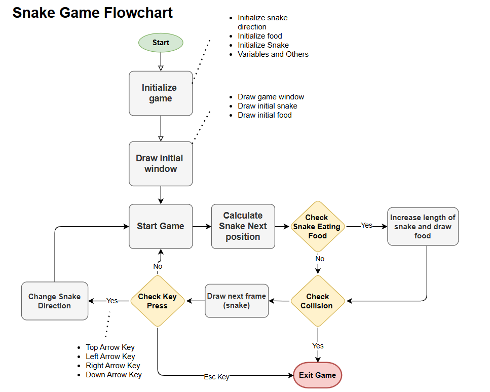

# Snake Game in C 
This is a school assignment where it was required to create a classical snake game using C.
reminder : The gameplay of the snake game is simple. There are three game objects:

Snake: The snake automatically moves into given direction till we change it. It has a mouth and tail.
Fruit: The object that snake has to eat to grow.
Walls: They are the boundary of the game area.

These objects work according to the game rules which are as follows:

The snake moves at a constant speed in one direction, and we can change its direction using the movement keys. However, the snake can only turn 90° at a time.
The objective is to eat as many fruits as possible, which will make the snake to grow in length.
The game ends if the snake collides with the boundary or its own body.

## Algorithm

 

the flowchart above illustrates the algorithm implemented

| Function | Role |
|----------|------|
| `setup()` | Initializes the snake, direction, score, and the 3 apples. |
| `draw()` | Renders the board, snake, apples, and HUD using ncurses. |
| `input()` | Reads keyboard events (arrow keys, QDZW, speed, pause, save, load, quit). |
| `logic()` | Moves the snake, checks wall/tail collisions, and handles apple consumption. |
| `saveGame()` / `loadGame()` | Persist and restore the full game state to `savegame.txt`. |
| `generateApples()` | Places 3 new apples at random positions after all 3 are eaten. |

## Features

- Playable with Arrow Keys or QDZW (AZERTY layout)
- 3 apples at a time — eat all 3 to grow
- Two speeds (Slow / Fast)
- Pause with 'p'
- Save and Load game state with 's' and 'l'

## Versions

- `snake.c`   — First version using Windows conio.h (does not compile on Linux)
- `snake2.c`  — Basic ncurses (linux library) version (single apple, no save/pause)
- `snake3.c`  — Final version with all features

## Build & Run on (Linux/Fedora)

``bash
    sudo dnf install ncurses-devel
    gcc snake3.c -o snake3 -lncurses
    ./snake3